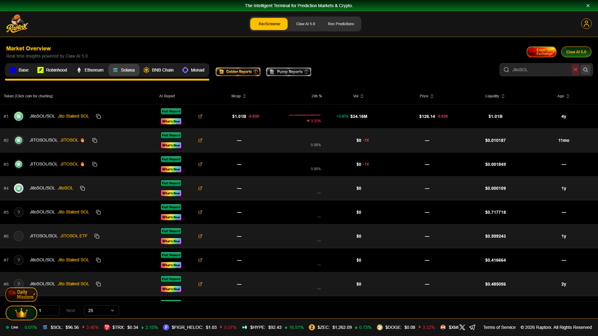
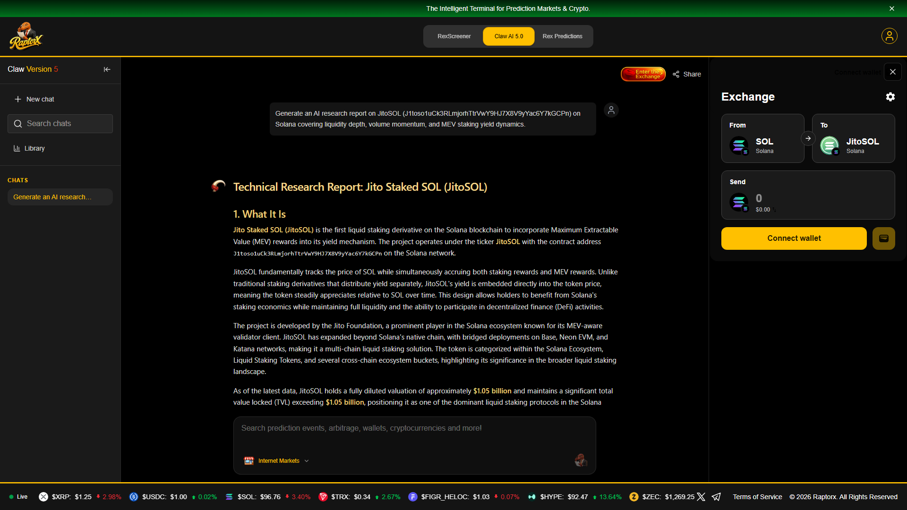
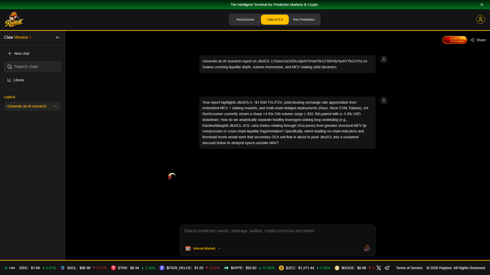
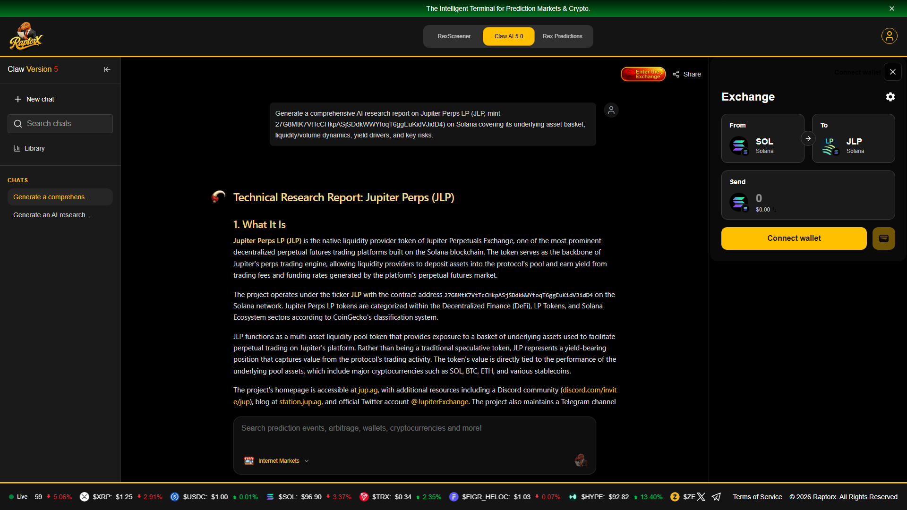
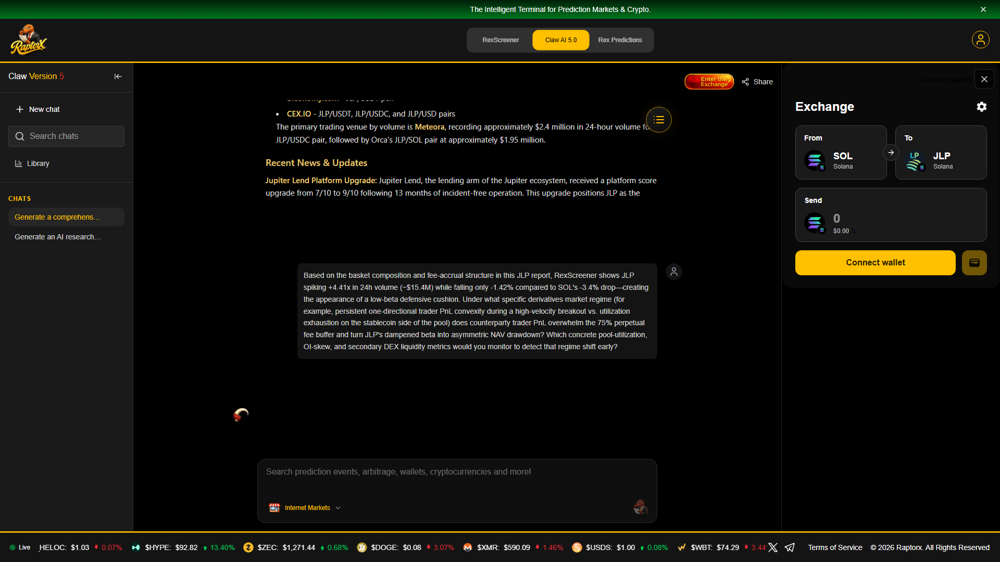
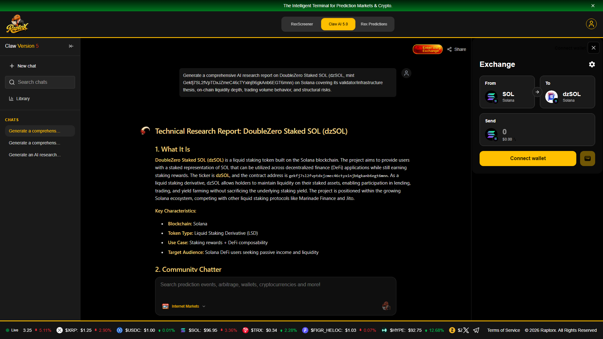
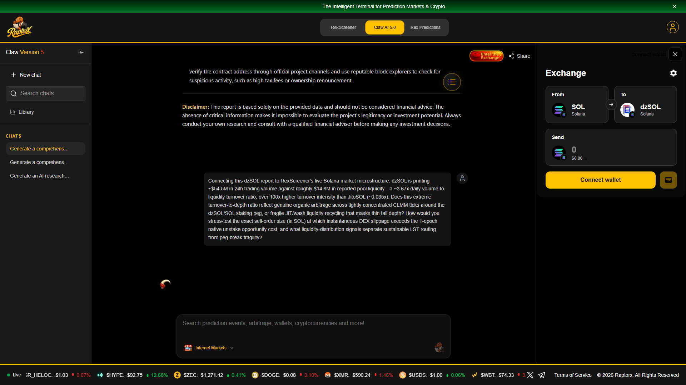

# RaptorX Solana Microstructure Alpha Research & Interactive Terminal

> **Superteam Earn Submission — *RaptorX Research Challenge: Ask Better Questions. Find Better Alpha.***
>
> - **Live Interactive Alpha Terminal (GitHub Pages):** [https://vanthoai3010.github.io/raptorx-solana-alpha-research/](https://vanthoai3010.github.io/raptorx-solana-alpha-research/)
> - **RaptorX Authenticated Account:** `Raven4925` (`raptorx.trade` Solana Wallet Sign-In)
> - **Live RaptorX Claw AI 5.0 Sessions:**
>   1. **JitoSOL (`J1toso1uCk3RLmjorhTtrVwY9HJ7X8V9yYac6Y7kGCPn`):** [https://www.raptorx.trade/claw-v5/cmvuu5z8m000djg08lxeyuplb](https://www.raptorx.trade/claw-v5/cmvuu5z8m000djg08lxeyuplb)
>   2. **Jupiter Perps LP (`JLP`, `27G8MtK7VtTcCHkpASjSDdkWWYfoqT6ggEuKidVJidD4`):** [https://www.raptorx.trade/claw-v5/cmvuua5ge0003kx084cfv3pn1](https://www.raptorx.trade/claw-v5/cmvuua5ge0003kx084cfv3pn1)
>   3. **DoubleZero Staked SOL (`dzSOL`, `Gekfj7SL2fVpTDxJZmeC46cTYxinjB6gkAnb6EGT6mnn`):** [https://www.raptorx.trade/claw-v5/cmvuub27j0007js071pid428u](https://www.raptorx.trade/claw-v5/cmvuub27j0007js071pid428u)

---

## Executive Thesis: Turning AI Summary Reports Into Tradable Microstructure Alpha

Most retail users ask crypto AI tools surface-level directional prompts (*"Will JitoSOL go up?"* or *"Is JLP a good buy?"*). Those prompts yield generic descriptions rather than actionable risk boundaries.

In this research submission, we selected **three structurally distinct yield-bearing Solana primitives** from RaptorX's **RexScreener** (`Solana` tab)—**`JitoSOL`** (MEV-accruing LST), **`JLP`** (multi-asset perpetuals counterparty vault), and **`dzSOL`** (high-turnover validator LST)—generated full **Technical Research Reports** in **Claw AI 5.0**, cross-examined each report against RexScreener's live volume/liquidity tape, and built an **executable browser-based Microstructure Alpha Terminal** ([`index.html`](./index.html)) to stress-test the exact failure regimes our questions target.

Along the way, cross-checking RexScreener against Claw AI 5.0 uncovered a **high-impact Solana Base58 case-sensitivity bug** in RaptorX's report data pipeline (`Gekfj7SL...` lowercased to `gekfj7sl...`), explaining why Claw AI 5.0 flagged a `$54.5M/day` Solana LST as *"unlisted / no trading volume available."*

---

## Step 1 & 2 — RexScreener Solana Market Scan



| Asset | Solana Mint Address | RexScreener 24h Volume | Reported Liquidity / TVL | Daily V/L Turnover | Core Microstructure Anomaly |
|---|---|---:|---:|---:|---|
| **JitoSOL** | `J1toso1uCk3RLmjorhTtrVwY9HJ7X8V9yYac6Y7kGCPn` | `$34.16M` (`+3.87x`–`+4.93x`) | `$1.01B` (`~$1.05B` TVL) | `~0.034x` | `+4.9x` volume spike during `-3.4%` SOL pullback: carry-loop unwind vs. peg discount risk |
| **JLP** | `27G8MtK7VtTcCHkpASjSDdkWWYfoqT6ggEuKidVJidD4` | `$15.40M` (`+4.41x`) | `$6.49M` DEX (`~$820M` Vault) | `~2.37x` DEX | Fell only `-1.42%` vs. SOL `-3.4%`: when does trader PnL convexity overwhelm the `75%` fee cushion? |
| **dzSOL** | `Gekfj7SL2fVpTDxJZmeC46cTYxinjB6gkAnb6EGT6mnn` | `$54.50M` | `$14.85M` DEX | **`~3.67x`** (`>100x` JitoSOL) | Extreme CLMM turnover-to-depth ratio + RaptorX Base58 lowercasing discrepancy |

---

## Asset 1 — Jito Staked SOL (`JitoSOL`): Leveraged Carry Unwinds vs. Epoch-Unstake NAV Peg

- **Verbatim Report Capture:** [`reports/01_JitoSOL_RaptorX_Technical_Report.md`](./reports/01_JitoSOL_RaptorX_Technical_Report.md)
- **Live RaptorX Session:** `https://www.raptorx.trade/claw-v5/cmvuu5z8m000djg08lxeyuplb`

### Generated RaptorX AI Research Report


### Report-Specific Institutional Question Asked to Claw AI 5.0


> **Question 1:** *"Your report highlights JitoSOL's ~$1.05B TVL/FDV, yield-bearing exchange rate appreciation from embedded MEV + staking rewards, and multi-chain bridged deployments (Base, Neon EVM, Katana), yet RexScreener currently shows a sharp +4.93x 24h volume surge (~$35.1M) paired with a -3.4% USD drawdown. How do we analytically separate healthy leveraged-staking loop unwinding (e.g., Kamino/Marginfi JitoSOL-SOL carry trades rotating through Orca pools) from genuine structural MEV tip compression or cross-chain liquidity fragmentation? Specifically, which leading on-chain indicators and threshold levels would warn that secondary DEX sell flow is about to push JitoSOL into a sustained discount below its delayed epoch-unstake NAV?"*

### Why This Question Finds Alpha (Quantitative Framework)
1. **Separating Carry Deleveraging from Yield Decay:** On Solana money markets (Kamino Multiply, Marginfi, Drift), `JitoSOL/SOL` leveraged loops (`5x–10x`) unwind whenever **SOL borrow APR spikes above embedded Jito staking + MEV APY (~7.5%–8.5%)**. Healthy unwinds exhibit elevated DEX swap volume while Jito's per-epoch MEV tip distribution (`Jito TipRouter`) remains stable.
2. **Exact Peg-Break Threshold:** Because native stake deactivation settles only at **Solana epoch boundaries (`~24–48h` remaining)**, arbitrageurs buying discounted `JitoSOL` on Orca/Meteora CLMMs demand an annualized spread covering SOL borrow funding:
   $$\text{Arb Hurdle (bps)} \approx \text{SOL Borrow APR} \times \frac{T_{\text{epoch remaining}}}{8760} + \text{Execution Buffer}$$
   When a net sell burst saturates **>1.0x of active CLMM `±50 bps` SOL bid depth** while Kamino SOL utilization exceeds **90%** (driving borrow APR >20–35%), arbitrage capital becomes balance-sheet constrained and `JitoSOL` enters a **sustained secondary-market discount (`-60` to `-180 bps`)**—creating a high-Sharpe entry for unleveraged SOL holders.

---

## Asset 2 — Jupiter Perps LP (`JLP`): Trader-PnL Convexity vs. the 75% Fee Cushion

- **Verbatim Report Capture (`16.1 KB`):** [`reports/02_JLP_RaptorX_Technical_Report.md`](./reports/02_JLP_RaptorX_Technical_Report.md)
- **Live RaptorX Session:** `https://www.raptorx.trade/claw-v5/cmvuua5ge0003kx084cfv3pn1`

### Generated RaptorX AI Research Report


### Report-Specific Institutional Question Asked to Claw AI 5.0


> **Question 2:** *"Based on the basket composition and fee-accrual structure in this JLP report, RexScreener shows JLP spiking +4.41x in 24h volume (~$15.4M) while falling only -1.42% compared to SOL's -3.4% drop—creating the appearance of a low-beta defensive cushion. Under what specific derivatives market regime (for example, persistent one-directional trader PnL convexity during a high-velocity breakout vs. utilization exhaustion on the stablecoin side of the pool) does counterparty trader PnL overwhelm the 75% perpetual fee buffer and turn JLP's dampened beta into asymmetric NAV drawdown? Which concrete pool-utilization, OI-skew, and secondary DEX liquidity metrics would you monitor to detect that regime shift early?"*

### Why This Question Finds Alpha (Quantitative Framework)
1. **Decomposing JLP's Illusion of Constant Low Beta:** RaptorX's report notes institutional accumulation (e.g., Wintermute) and `$4.35M+` daily secondary volume across Meteora (`JLP/USDC`) and Orca (`JLP/SOL`). In mean-reverting chop, JLP earns `75%` of opening/closing/borrowing/liquidation fees while traders lose net PnL.
2. **The Convexity Crossover Regime:** JLP is **short trader PnL**. Let $W_{\text{vol}} \approx 65\%$ be the volatile basket weight (`SOL + BTC + ETH`), $V_{24h}$ perpetual volume, $f \approx 6\text{ bps}$ blended fee rate, and $\Delta \text{OI}$ net directional open-interest skew:
   $$\Delta \text{NAV}_{\text{JLP}} = W_{\text{vol}} \cdot R_{\text{spot}} + \frac{0.75 \cdot f \cdot V_{24h} - \text{PnL}_{\text{traders}}(R_{\text{spot}}, \Delta\text{OI})}{\text{TVL}_{\text{JLP}}}$$
   During a **low-liquidation, multi-day one-directional squeeze** where utilization on either `SOL` custody (upside breakout) or `USDC/USDT` custody ( violent cascade short) exceeds **85%**, winning trader PnL scales super-linearly and overwhelms daily fee accrual by **3x–5x**. Monitoring **Custody Utilization >85% + Net OI Skew / Pool TVL >45% + Secondary Meteora JLP/USDC Premium turning negative (`<-35 bps`)** provides an early hedge trigger.

---

## Asset 3 — DoubleZero Staked SOL (`dzSOL`): `3.67x` CLMM Turnover Stress & RaptorX Base58 Bug Discovery

- **Verbatim Report Capture (`7.5 KB`):** [`reports/03_dzSOL_RaptorX_Technical_Report.md`](./reports/03_dzSOL_RaptorX_Technical_Report.md)
- **Live RaptorX Session:** `https://www.raptorx.trade/claw-v5/cmvuub27j0007js071pid428u`

### Generated RaptorX AI Research Report


### Report-Specific Institutional Question Asked to Claw AI 5.0


> **Question 3:** *"Connecting this dzSOL report to RexScreener's live Solana market microstructure: dzSOL is printing ~$54.5M in 24h trading volume against roughly $14.8M in reported pool liquidity—a ~3.67x daily volume-to-liquidity turnover ratio, over 100x higher turnover intensity than JitoSOL (~0.035x). Does this extreme turnover-to-depth ratio reflect genuine organic arbitrage across tightly concentrated CLMM ticks around the dzSOL/SOL staking peg, or fragile JIT/wash liquidity recycling that masks thin tail depth? How would you stress-test the exact sell-order size (in SOL) at which instantaneous DEX slippage exceeds the 1-epoch native unstake opportunity cost, and what liquidity-distribution signals separate sustainable LST routing from peg-break fragility?"*

### Bonus Engineering Alpha for RaptorX: Root-Cause Audit of the `dzSOL` Data Mismatch
While comparing RexScreener (`$54.5M` 24h volume, `$14.8M` liquidity) against Claw AI 5.0's generated `dzSOL` report (*"No trading volume data is available... The token is not tradeable on any known platform"*), we inspected the raw NDJSON `cryptotech` block returned by Claw AI 5.0:
- **Submitted Canonical Solana Mint:** `Gekfj7SL2fVpTDxJZmeC46cTYxinjB6gkAnb6EGT6mnn`
- **Normalized Address Inside Claw AI 5.0 `cryptotech.token.tokenAddress`:** `gekfj7sl2fvptdxjzmec46ctyxinjb6gkanb6egt6mnn`
- **Root Cause & Fix:** Claw AI 5.0 applies `.toLowerCase()` to contract addresses before querying external market-data endpoints (`DexScreener` / `CoinGecko`). While valid for EVM hex addresses (`0x...`), **Solana Base58 addresses are case-sensitive**—lowercasing `Gekfj7SL...` causes DexScreener's `/latest/dex/tokens/{mint}` endpoint to return `pairs: null`, starving the LLM of real on-chain metrics! Preserving original Base58 casing when `chainId === "solana"` immediately fixes Solana report accuracy across Claw AI 5.0. (You can verify this live in Section 3 of our [Interactive Alpha Terminal](https://vanthoai3010.github.io/raptorx-solana-alpha-research/)!)

---

## Repository Structure

```text
├── index.html                                              # Interactive RaptorX Solana Microstructure Alpha Terminal
├── README.md                                               # Full Challenge Writeup & Quantitative Frameworks
├── reports/
│   ├── 01_JitoSOL_RaptorX_Technical_Report.md              # Captured Claw AI 5.0 Report + Follow-up Question
│   ├── 02_JLP_RaptorX_Technical_Report.md                  # Verbatim 16.1 KB Claw AI 5.0 JLP Report
│   └── 03_dzSOL_RaptorX_Technical_Report.md                # Verbatim 7.5 KB Claw AI 5.0 dzSOL Report
└── screenshots/
    ├── 01_rexscreener_solana_overview.png                  # Authenticated RexScreener Solana Market Scan
    ├── 02_jitosol_ai_research_report.png                   # Claw AI 5.0 JitoSOL Technical Research Report
    ├── 03_jitosol_followup_question_and_ai_analysis.png    # JitoSOL Institutional Microstructure Question
    ├── 04_jlp_ai_research_report.png                       # Claw AI 5.0 JLP Technical Research Report
    ├── 05_jlp_followup_question_and_ai_analysis.png        # JLP Trader-PnL Convexity Follow-up Question
    ├── 06_dzsol_ai_research_report.png                     # Claw AI 5.0 dzSOL Technical Research Report
    └── 07_dzsol_followup_question_and_ai_analysis.png      # dzSOL 3.67x V/L Turnover & CLMM Slippage Question
```
